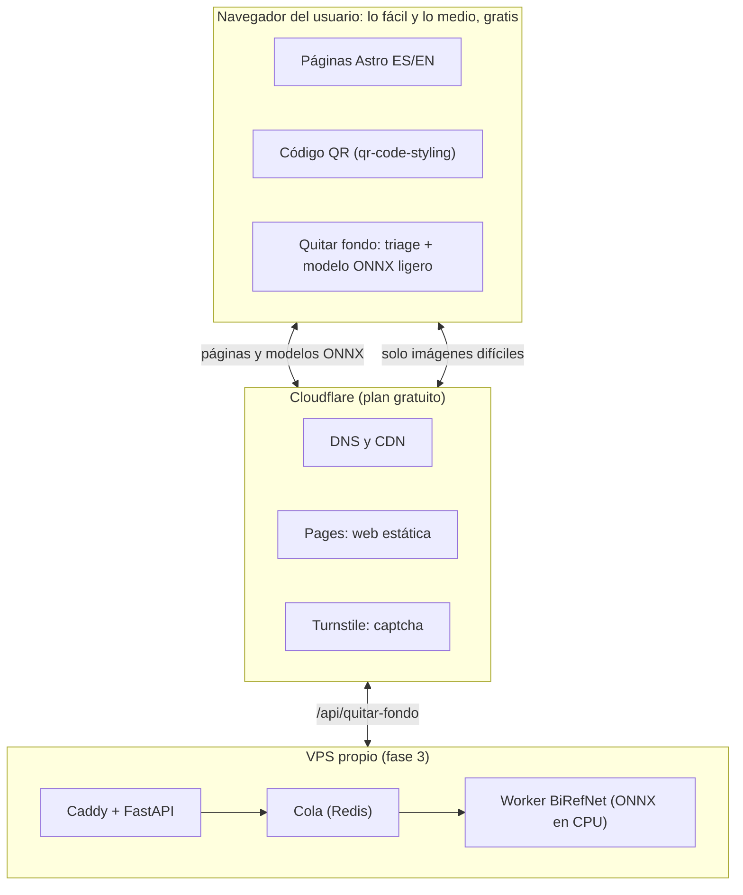

# YaldaTools — Especificaciones

Versión: 24 de noviembre de 2026. Fuente editable: el documento "YaldaTools — Especificaciones" en Claude.

## Visión y principios

YaldaTools es un sitio de herramientas pequeñas y gratuitas en `yaldatools.yaldapika.com`, con estética Windows 95 y una mascota anime. Se financia con donaciones que cubren el VPS y el tiempo de desarrollo.

- **Local primero:** todo lo que pueda correr en el navegador corre ahí. El servidor solo se usa cuando aporta calidad real, y se avisa.
- **Sin fricción:** sin registro, sin marcas de agua, sin anuncios y sin QR que caducan.
- **Bilingüe:** español e inglés desde el primer día.
- **Coste fijo:** el único gasto recurrente es el VPS (más el dominio, que ya existe).

## Alcance de la v1

La v1 sale con dos herramientas, el Código QR y el Quitar fondo, más la portada, ES/EN y la página de apoyo.

| Pieza | Entra en v1 | Dónde corre | Notas |
| --- | --- | --- | --- |
| Portada (escritorio Win95) | Sí | Navegador | Iconos de programas, buscador, mascota |
| Código QR | Sí | Navegador | Coste cero |
| Quitar fondo: fácil y media | Sí | Navegador | Modelo ONNX en WebGPU/WASM |
| Quitar fondo: difícil | Fase 3 | VPS | Cola + modelo pesado en CPU |
| Página Apoyar | Sí (sin enlace) | Navegador | El enlace se añade cuando exista la plataforma |
| Comprimir imagen, PDF, EXIF, contraseñas | No | Navegador | Se muestran como "pronto" |
| Cuentas de usuario, historial | No | — | No hace falta: nada se guarda |

## Requisitos por herramienta

### Código QR

- Tipos: URL, texto, WiFi (SSID, contraseña y seguridad), contacto vCard, WhatsApp y email.
- Apariencia: color de puntos y de fondo, forma de puntos (cuadrado, redondo, puntos) y logo central opcional.
- Al poner un logo, la corrección de errores pasa sola a H.
- Exportar a PNG (hasta 2048 px) y SVG, y copiar al portapapeles.
- Aviso de contraste si los colores elegidos dificultan el escaneo.
- Librería propuesta: `qr-code-styling` (MIT).

### Quitar fondo

1. El usuario sube o pega una imagen (JPG, PNG o WebP; hasta 25 MB, que se reduce a 2048 px de lado mayor).
2. El triage en el navegador mide la uniformidad del borde, el contraste y la densidad de bordes.
3. Si el fondo es uniforme, se recorta con *flood fill* (OpenCV.js).
4. Si no, pasa por un modelo ligero en el navegador (ISNet o MODNet cuantizado), del que se mide la zona de alfa dudosa.
5. Si la zona dudosa supera un umbral a calibrar (punto de partida: 15 %), se ofrece refinar en el servidor con aviso de privacidad. En la v1 este paso queda desactivado.
6. El resultado tiene fondo transparente, blanco o de color, y se descarga en PNG.

El panel de diagnóstico enseña la dificultad, el método elegido y dónde se procesó. Esa transparencia forma parte del encanto del producto.

## Internacionalización ES/EN

Cada idioma tiene sus propias URLs, así Google indexa las dos versiones por separado.

- **Rutas:** `/es/qr`, `/es/quitar-fondo` y `/en/qr-code`, `/en/remove-background`. El slug se traduce porque es lo que la gente busca.
- **Idioma inicial:** al entrar en `/` se elige según `Accept-Language`; si no hay coincidencia, español. La elección manual se guarda en `localStorage`.
- **Selector:** el botón ES | EN de la bandeja del taskbar lleva a la misma herramienta en el otro idioma.
- **SEO:** etiquetas `hreflang` entre pares, y título y descripción propios por página e idioma.
- **Textos:** un archivo JSON por idioma (`es.json`, `en.json`) con claves por herramienta. Los diálogos de la mascota también se traducen.
- **Implementación:** el i18n de rutas nativo de Astro, sin librería extra.

## Sistema visual: Windows 95 + anime

El estilo es un escritorio retro con ventanas biseladas, iconos pixel art por programa, un fondo de pantalla de ilustración anime y un toque "sakura" en las barras de título. La referencia completa está en [`design/mockup`](../design/mockup).

| Token | Valor | Uso |
| --- | --- | --- |
| Escritorio | #008080 | Fondo de reserva si no carga el wallpaper |
| Ventana | #c0c0c0 | Ventanas, botones, taskbar |
| Marino | #000080 | Barra de título, enlaces, progreso |
| Sakura | #a4307f | Acento de marca, final del degradado de la barra de título |
| Tooltip | #ffffe1 | Avisos y consejos |
| Rosa suave | #f3d6e7 | Fondos de la mascota |

- **Biseles:** relieve con bordes blanco y negro más sombras internas gris claro y oscuro; los campos y los botones pulsados van hundidos.
- **Iconos:** pixel art de 16×16 escalado a 48 px, con contorno negro para leerse sobre el wallpaper.
- **Wallpaper:** una ilustración anime en WebP de menos de 100 KB, con `background-size: cover` y color de reserva. Ver [`fondo-de-pantalla.md`](fondo-de-pantalla.md).
- **Tipografía:** Pixelify Sans para títulos, Tahoma o Verdana del sistema para la interfaz (14–15 px) y VT323 para el reloj.
- **Base CSS:** `98.css` (MIT) como punto de partida, personalizada con los tokens de arriba.
- **Legal:** nada de logos, nombres ni fuentes de Microsoft. El botón Inicio dice "Yalda" y lleva un icono propio.
- **Accesibilidad:** objetivos táctiles de al menos 44 px, contraste AA y `prefers-reduced-motion` para pausar las animaciones.
- **Móvil:** una sola ventana a pantalla completa, el taskbar abajo y la lista de herramientas como botones grandes.

## GIFs de la mascota

La recomendación es tener una mascota original propia y no usar GIFs de series anime. Los GIFs de Giphy o Tenor sacados de series son material con copyright de los estudios: en un sitio público que pide donaciones se arriesga una retirada del contenido, y además no construyen marca.

### Animaciones necesarias

| Animación | Dónde aparece | Tamaño en pantalla |
| --- | --- | --- |
| Saludando (reposo) | Portada | 140×140 |
| Señalando o dando un consejo | Herramientas | 96×96 |
| Recortando con tijeras | Quitar fondo, procesando | 110×110 |
| Celebrando | Descarga lista | 96×96 |
| Confundida | Errores y 404 | 120×120 |
| Con taza de café | Apoyar el proyecto | 96×96 |

### Cómo conseguirlos

Los precios son aproximados, de memoria; hay que verificarlos al contratar.

| Opción | Coste aprox. | Ventajas | Riesgos |
| --- | --- | --- | --- |
| Encargar a un artista de pixel art (VGen, Skeb, Fiverr, r/HungryArtists) | 30–150 USD por animación; un paquete de 6 a partir de unos 200 USD | Mascota única, licencia comercial por escrito | Coste inicial; hay que pedir derechos de uso comercial explícitos |
| Paquetes de assets en itch.io | 0–15 USD | Rápido y barato | Revisar la licencia de cada paquete; otras webs pueden usar la misma mascota |
| OpenGameArt (CC0 o CC-BY) | 0 | Gratis y legal | Poca oferta de estilo anime; CC-BY exige dar crédito |
| Dibujarla tú (Aseprite ~20 USD; Piskel o LibreSprite gratis) | 0–20 USD + tiempo | Control total | Curva de aprendizaje de la animación |
| Generada con IA | Bajo | Rápido para bocetos | Derechos poco claros, cuesta mantener el mismo personaje y mala recepción en la comunidad de pixel art |

Plan propuesto: lanzar con huecos de placeholder o con un paquete CC0, y encargar las 6 animaciones cuando lleguen las primeras donaciones.

### Formato técnico

- Se dibuja a 1× (por ejemplo 48×48 o 64×64) y se escala a 2× o 3× con `image-rendering: pixelated`.
- En vez de GIF, mejor una hoja de sprites PNG animada con `steps()` en CSS: pesa menos, admite alfa completo y se pausa fácilmente con `prefers-reduced-motion`. WebP animado es la alternativa.
- Peso objetivo: menos de 60 KB por animación.
- Encargo para el artista: chica anime de estilo chibi, paleta con sakura #a4307f y marino #000080, fondo transparente, 6 animaciones en bucle de 4 a 8 fotogramas, entrega del archivo fuente `.aseprite` y licencia comercial.

## Arquitectura y despliegue

El sitio es estático (Astro) y se sirve gratis desde Cloudflare Pages en `yaldatools.yaldapika.com`. El VPS solo entra en la fase 3, para los recortes difíciles.

Si el VPS está saturado o caído, la web avisa y se queda con el resultado del navegador. El subdominio se configura con un CNAME `yaldatools` en el DNS de yaldapika.com que apunte a Cloudflare Pages. Si se prefiere servir todo desde el VPS, Caddy puede alojar también la web estática.

| Pieza | Tecnología | Licencia |
| --- | --- | --- |
| Web | Astro + TypeScript, `98.css` | MIT |
| QR | `qr-code-styling` | MIT |
| Recorte en el navegador | `onnxruntime-web`, OpenCV.js, ISNet o MODNet | MIT / Apache 2.0 |
| Recorte en el servidor | FastAPI, ONNX Runtime, BiRefNet | MIT |
| Infraestructura | Cloudflare Pages + Docker Compose en el VPS | — |

## Donaciones, privacidad, accesibilidad y SEO

### Donaciones

- Habrá un botón "Apoyar el proyecto" en el taskbar y una página `/apoyar` (`/en/support`). El enlace queda en una sola variable de configuración y se rellena cuando exista la plataforma.
- La mascota con taza de café aparece después de cada descarga, con un mensaje suave y que se puede cerrar.
- La página de apoyo explica en qué se gasta el dinero: el VPS y el tiempo para hacer más herramientas. Lleva una barra de meta mensual opcional y una lista de próximas herramientas.
- Candidatas para después: Ko-fi (sin comisión de plataforma) o GitHub Sponsors.

### Privacidad

- Las herramientas locales no envían nada; la barra de estado lo dice ("0 bytes enviados").
- Si una imagen va al servidor, se avisa antes, se borra al terminar y hay una opción de procesarla solo en el dispositivo.
- Analítica sin cookies (Cloudflare Web Analytics o Plausible autoalojado), así que no hace falta banner de cookies.

### Accesibilidad

- Todo se puede usar con el teclado: los iconos del escritorio son enlaces reales y las ventanas no se arrastran en móvil.
- Contraste AA, `aria-label` en los botones de icono y GIFs con texto alternativo o marcados como decorativos.

### SEO

- Una página estática por herramienta e idioma, con un título que coincida con la búsqueda real ("Generador de QR WiFi gratis").
- Cada página lleva debajo un texto breve de ayuda y preguntas frecuentes, en estilo "Léeme.txt".
- Sitemap, `hreflang` y Open Graph con una imagen retro por herramienta.

## Fases y decisiones pendientes

1. **Fase 1:** base del sitio, ES/EN, portada y Código QR. Esfuerzo estimado: 1 semana.
2. **Fase 2:** Quitar fondo en el navegador, con triage y diagnóstico. Esfuerzo estimado: 1–2 semanas.
3. **Fase 3:** backend en el VPS para los casos difíciles, con cola y protección. Esfuerzo estimado: 1 semana.
4. **Fase 4:** plataforma de donaciones, mascota y wallpaper definitivos, y una herramienta nueva cada 2–4 semanas.

Decisiones pendientes:

- [ ] Características del VPS: RAM, núcleos, sistema operativo y si tiene Docker.
- [ ] Si la web estática se sirve desde Cloudflare Pages o desde el propio VPS.
- [ ] Nombre y personalidad de la mascota.
- [ ] Cómo conseguir los GIFs: encargo, paquete o dibujo propio.
- [x] Wallpaper: ilustración de ノーコピーライトガール, con uso comercial permitido y crédito (ver [`fondo-de-pantalla.md`](fondo-de-pantalla.md)).
- [ ] Correo de contacto público.
- [ ] Plataforma de donaciones (más adelante).
- [ ] Barra de título: variante "sakura" o "clásica".
